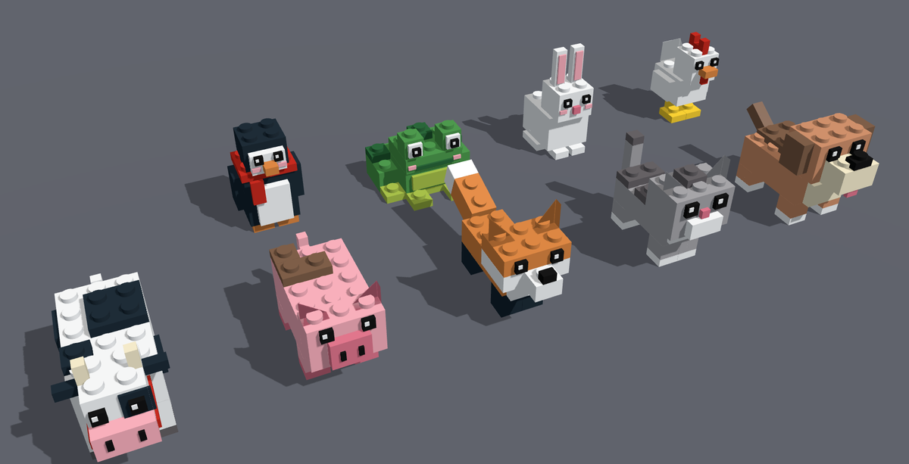

# Stud Animals

Clean, blocky animals for Roblox built from classic studded bricks: studs on top, inlets underneath, classic brick colours. Each animal also has a small procedural idle animation.



**Animals:** Dog, Cat, Fox, Pig, Cow, Chicken, Bunny, Frog, Penguin

| Animal  | Details                                   | Idle motion                  |
|---------|-------------------------------------------|------------------------------|
| Dog     | Floppy ears, brown saddle, studded nose   | Head tilt, wagging tail      |
| Cat     | Grey tabby stripes, wedge ears            | Ear twitch, swishing tail    |
| Fox     | Black socks, white-tipped bushy tail      | Ear twitch, tail sway        |
| Pig     | Mud splotches, curly tail                 | Head nod, quick tail wiggle  |
| Cow     | Spots, horns, red collar with a bell      | Ear flick, tail swish        |
| Chicken | Studded comb, wedge tail feathers         | Pecking, wing flaps          |
| Bunny   | Tall pink-lined ears, round tail          | Hopping, ear twitch          |
| Frog    | Goggle eyes, spotted back legs            | Hopping                      |
| Penguin | Red scarf, rosy cheeks                    | Waddle, flipper flaps        |

## Setup

### With Rojo
```bash
rojo serve        # then connect from the Rojo plugin in Studio
# or
rojo build -o StudAnimals.rbxlx
```

### Without Rojo
Create these in Studio and paste in the matching files:

| Studio location                          | Type         | File                                           |
|------------------------------------------|--------------|------------------------------------------------|
| `ReplicatedStorage.StudAnimals`          | ModuleScript | `src/shared/StudAnimals/init.luau`             |
| `ReplicatedStorage.StudAnimals.Designs`  | ModuleScript | `src/shared/StudAnimals/Designs.luau`          |
| `ReplicatedStorage.StudAnimals.Palette`  | ModuleScript | `src/shared/StudAnimals/Palette.luau`          |
| `ServerScriptService.AnimalShowcase`     | Script       | `src/server/AnimalShowcase.server.luau`        |
| `StarterPlayerScripts.AnimalAnimator`    | LocalScript  | `src/client/AnimalAnimator.client.luau`        |

Press Play to see all nine animals on studded pedestals in a ring around the spawn.

## Using it in your game

```lua
local StudAnimals = require(game.ReplicatedStorage.StudAnimals)

-- The CFrame is the ground point under the animal. Animals face LookVector.
local cow = StudAnimals.Build("Cow", {
	cframe = CFrame.new(10, 0, 0) * CFrame.Angles(0, math.rad(45), 0),
	scale = 2,          -- optional
	parent = workspace, -- optional
})

print(StudAnimals.List()) --> { "Dog", "Cat", "Fox", ... }
```

To move an animal, call `model:PivotTo(cframe)`. The invisible, anchored `Root` part is the hitbox and the pivot point.

## How it works

- **`Designs.luau`**: each animal is a plain-data list of bricks (size, position, palette colour). Widths snap to whole studs and heights to plates (0.4), so the studs line up cleanly. Bricks 1x1 or bigger get studs automatically. `studs = true/false` overrides that.
- **`init.luau`**: turns a design into a Model. It adds the anchored `Root`, joins the body to it with a Motor6D, and joins each moving part (head, ears, tail, wings) with its own Motor6D. Animation settings are stored as attributes on those joints.
- **`AnimalAnimator`**: a client-side loop that reads those attributes and animates the joints (`Swing`, `Twitch`, `Bob`, `Hop`). It only touches joints, never positions, so it can't conflict with the server. Animals more than 200 studs from the camera are skipped.

### Adding your own animal

Add an entry to `Designs.luau` and its name to `Designs.Order`:

```lua
Designs.Duck = (function()
	local p = {}
	add(p, P("Body", { 2, 1.2, 3 }, { 0, 0.6, 0 }, "yellow", { root = true }))
	add(p, P("Head", { 1.6, 1.6, 1.6 }, { 0, 2.0, -1.0 }, "yellow",
		{ anim = swing({ 0, 1.2, -1.0 }, "X", 8, 2) }))
	add(p, P("Beak", { 1, 0.4, 0.6 }, { 0, 1.8, -2.1 }, "orange", { parent = "Head" }))
	eyes(p, 0.45, 2.2, -1.8, 0.4, "Head")
	return { displayName = "Duck", parts = p }
end)()
```

Helpers: `pair` mirrors a brick to the left side, `eyes` adds shiny eyes, and `swing`/`twitch` set up joint animation. Animals face **-Z** and Y = 0 is the ground.

> Studs use Roblox's classic `SurfaceType.Studs` / `Inlet` surfaces on `Plastic`, so no image assets or uploads are needed.
